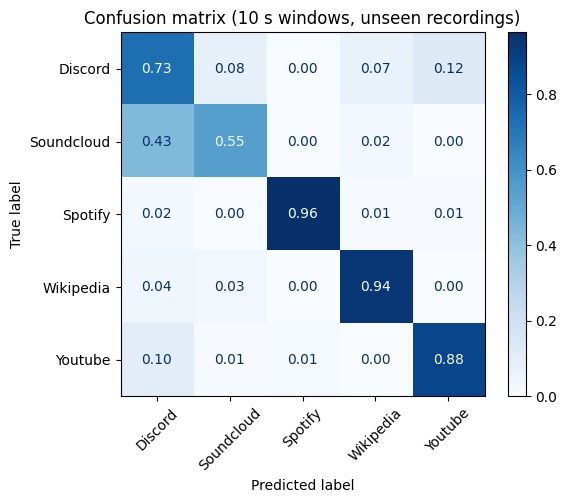

# What Does Encrypted Traffic Reveal? Application Fingerprinting from Network Metadata

**DD239 Computer Security | Project: Network Traffic Analysis**  
Aylin Dora Leblebici | David Johnsson Kärrbrink | Deniz Kandemir | Nikolaj Goj

## 1. Problem statement

This project asks: “Can a passive observer infer what a user is doing, even though all communication content is encrypted?”

### Threat model

- **Attacker:** Passive network observer, between user & the internet. (for eg. ISP, WI-FI access point operator or anyone who can can mirror the traffic on the network)
- **Attacker capabilities:** Can observe every packet that crosses the network link, including timestamp, size in bytes, and source/destination IP.
- **Attacker limitation:** Cannot decrypt payload content, cannot modify or inject traffic.
- **Attacker goal:** Determine which application the user is currently using, based on encrypted traffic metadata.
- **Victim:** Any user whose traffic passes through the attacker’s observation point while using one of the five applications

We define a five-class problem covering different kinds of activity:

| Class | Activity type |
|---|---|
| Youtube | Video streaming |
| Spotify | Music streaming |
| SoundCloud | Music streaming |
| Discord | Real-time voice messaging |
| Wikipedia | Web browsing |

If a simple classifier can separate these classes well above chance, using only metadata, then encryption alone does not protect the user's activity from the observer described above.

## 2. Reference

Most of the network traffic today is encrypted using HTTPS, with data from 2023 showing that 95% of all network traffic is encrypted (Sharma & Habibi Lashkari, 2025). This is, as many of us know, to provide confidentiality and integrity by preventing unauthorized observers from reading or modifying the data being sent. However, machine learning is widely used to inspect and analyze encrypted traffic in order to draw different conclusions. Common ways of doing this is by looking at encrypted traffic to see if malware or other unauthorized changes have been hidden in the encrypted traffic (Sharma & Habibi Lashkari, 2025) or to see if specific features of the traffic are distinguishable despite encryption, like packet size, direction and timing (Wright et al., 2006). We aim to try this ourselves by training a model on encrypted network traffic and then testing it while recording new encrypted network traffic to see how well it performs as well as what affects these results.

### 2.1 Sources used

Sharma, A., & Habibi Lashkari, A. (2025). A survey on encrypted network traffic: A comprehensive survey of identification/classification techniques, challenges, and future directions. *Computer Networks, 257*, Article 110984. https://doi.org/10.1016/j.comnet.2024.110984

Wright, C. V., Monrose, F., & Masson, G. M. (2006). On inferring application protocol behaviors in encrypted network traffic. *Journal of Machine Learning Research, 7*(100), 2745–2769. https://jmlr.org/papers/v7/wright06a.html

## 3. Documentation of the project

### 3.1 Repository contents

| File | Purpose |
|---|---|
| `FINAL_DD2391_PROJECT.ipynb` | Colab notebook: feature extraction, dataset construction, training, evaluation, figures, model export |
| `live_demo.py` | Live classifier that runs on a laptop and predicts the current application every 10 seconds |
| `traffic_model.joblib` | Trained model exported from the notebook (used by `live_demo.py`) |
| `figures/` | Figures used in this report |

The raw captures (.pcapng) are stored in a shared Google Drive folder (Computer_Security_Project/dataset) because of their size. The raw captures are not included because they contain personal information such as our IP addresses and the services we connected to. They can be shared with the course staff on request.

### 3.2 Data collection

- Traffic was captured with Wireshark while one application was used at a time, in repeated sessions.
- Each capture contains a single activity, so the folder name gives the ground-truth label.
- 74 captures in total:

| Class | Captures | 10s windows |
|---|---:|---:|
| YouTube | 20 | 153 |
| Wikipedia | 20 | 114 |
| Spotify | 10 | 111 |
| Discord | 14 | 105 |
| SoundCloud | 10 | 44 |
| **Total** | **74** | **527** |

### 3.3 Reading packets without decryption

`tshark` is used to export only the following fields for each packet: `frame.time_epoch`, `frame.len`, `ip.src` / `ipv6.src`, `ip.dst` / `ipv6.dst`.

Payloads are never read or decrypted. The direction of each packet is derived from the addresses: the address that appears in the most packets is the user's own machine. Packets sent from it are labelled outgoing (+1), and packets sent to it are labelled incoming (−1).

### 3.4 Features

Each capture is cut into consecutive 10-second windows (windows with fewer than 20 packets are discarded). For each window we compute 25 features covering all the metadata categories required by the assignment:

| Category | Features |
|---|---|
| Number of packets | `n_packets`, `packets_per_sec`, `bytes_per_sec` |
| Connection duration | `duration` (active time inside the window) |
| Packet sizes | mean / std / max of all, outgoing and incoming packet sizes |
| Packet directions | `frac_outgoing`, `in_out_bytes` (incoming / outgoing bytes) |
| Packet timings | mean / std / max of inter-packet gaps |
| Burst sizes | `n_bursts`, mean / std / max of outgoing and incoming burst sizes |

We use windows instead of whole captures for three reasons:

1. It models a realistic attacker who observes only a short slice of traffic.
2. It enables the live demo, which makes one prediction every 10 seconds.
3. It produces 527 training examples instead of 74.

### 3.5 Classifier

We use a Random Forest with 300 trees and `class_weight='balanced'` (to compensate for SoundCloud having fewer windows). Random forests work well on small tabular datasets, need no feature scaling, and report which features they rely on most. This last property is what lets us identify which kind of metadata leaks the most.

### 3.6 Live demo

`live_demo.py` turns the attack into a working tool:

1. Capture 10 seconds of traffic on the Wi-Fi interface using `tshark`.
2. Extract the same 25 features using the same code as in the notebook.
3. Predict with the exported model and print the most likely application with its probability, plus the runner-up.
4. Repeat.

Example output:

```text
[01:29:56] Youtube      60%   (next: Spotify 34%, 3116 packets)
[01:30:07] Youtube      83%   (next: Discord 8%, 4987 packets)
```

How to run (macOS):

```bash
# 1. Install Wireshark
# 2. Set up Python
python3 -m venv venv
source venv/bin/activate
pip install scikit-learn==1.6.1 pandas joblib
# 3. Run (traffic_model.joblib must be in the same folder)
python live_demo.py          # default interface: en0 (Wi-Fi)
```

The scikit-learn version must match the version used to train the model (1.6.1).

## 4. Documentation on testing the project

### 4.1 Evaluation method: unseen recordings

The assignment requires evaluation on previously unseen traces. Windows from the same capture are very similar to each other. If one window of a capture were used in training and the next window in testing, the model could "recognise the recording" rather than the application, which would inflate the accuracy.

We therefore use 5-fold cross-validation grouped by capture (`StratifiedGroupKFold`). All windows of a capture are always in the same fold, so every prediction is made on a recording the model has never seen during training. Stratification keeps the class balance similar across folds.

As a reference point we use a baseline that always predicts the largest class (YouTube). It reaches 29.0% accuracy.

### 4.2 Main result (10-second windows)

Accuracy: 85.4%, compared with a baseline of 29.0%.


### 4.3 Which applications are confused?



- Spotify (96%) and Wikipedia (94%) are almost never confused with other classes. Browsing produces short bursts followed by silence, which is a very different shape from streaming.
- The main error is SoundCloud being predicted as Discord (43%). Both carry continuous audio, so their packet size and timing profiles are similar. The confusion is mostly one-way, which is consistent with SoundCloud having fewer than half as many windows as Discord.

In summary: applications of a different type (streaming vs. browsing) are separated almost perfectly, while applications of the same type (two audio streams) are harder to tell apart.

### 4.4 Which metadata leaks the most?


The most important feature by far is `in_size_max`, the largest incoming packet in a window (importance ≈ 0.125, about twice the next feature). A likely explanation is that applications use different transport protocols and packet-size limits (for example QUIC vs. TCP, or small real-time voice packets). The maximum packet size therefore acts as a protocol fingerprint.

The rest of the top ten are almost all packet size and burst size features. Timing features do not appear in the top ten.

### 4.5 How long must the attacker observe?

The same evaluation was repeated with different window lengths:

| Observation window | 2s | 5s | 10s | 30s | Whole capture |
|---|---:|---:|---:|---:|---:|
| Accuracy | 81.2% | 84.0% | 85.4% | 84.7% | 89.2% |


Two seconds of encrypted traffic are already enough to identify the application in 81% of cases.

### 4.6 Live test

`live_demo.py` was run on a laptop while watching YouTube. The model had never seen this traffic:

```text
[01:29:56] Youtube      60%   (next: Spotify 34%, 3116 packets)
[01:30:07] Youtube      83%   (next: Discord 8%, 4987 packets)
[01:30:17] Discord      56%   (next: Youtube 35%, 157 packets)
[01:30:28] Youtube      65%   (next: Spotify 23%, 8380 packets)
```

Observations from live testing:

- Predictions are most reliable while an application is actively transferring data.
- When the user switches applications, the first window after the switch contains traffic from both applications. A correct prediction usually appears one window (≈10 s) later.
- Background traffic (cloud sync, updates) mixes with the user's traffic and should be minimised for a clean demonstration.

### 4.7 Limitations

- **Small label set:** We test only five applications. A real-world attacker would face hundreds, making classification harder as many apps could share similar traffic profiles.
- **One application at a time:** Each capture contains traffic from a single application. In practice users run multiple applications simultaneously, and the mixed traffic would be harder to classify.
- **Limited dataset:** 74 captures producing 527 windows is small by machine-learning standards. A larger, more diverse dataset might yield different accuracy figures.
- **No adversarial defenses tested:** We did not evaluate countermeasures such as traffic padding, tunneling through a VPN with constant-rate cover traffic, or packet-size randomisation. The classifier's robustness against such defenses is unknown.
- **Background traffic:** Operating-system updates, cloud sync, and other background processes inject noise into the captures. We tried to minimize this during collection but could not eliminate it completely.
- **Uneven amount of captures from each application:** The captures for Discord and Soundcloud are less than the other applications which could skew the model’s ability to detect traffic from those applications compared to the ones with more captures. However, as previously mentioned, this is handled by using `class_weight='balanced'` in Random Forest.

## 5. Individual contributions

### Aylin Dora Leblebici

Like the rest of the group, I contributed to data collection by recording network traffic in Wireshark for the five target applications. I also took part in the group discussions where we decided on the scope of the project, which applications to include, and how to structure the pipeline.

My main code contribution was the feature extraction pipeline: the functions `stats`, `find_bursts`, and `extract_features`. These functions take the raw packet data (timestamps, sizes, and directions) and turn each 10-second window into a row of 25 numeric features that the classifier can learn from. The features cover packet counts, throughput, packet sizes for outgoing and incoming traffic separately, inter-packet timing, and burst patterns. Designing these features was important because they define exactly what metadata the model has access to, and therefore what it can and cannot learn. The later analysis showed that the features I implemented, especially the packet size features, turned out to be the most revealing ones for identifying applications.

On the report side, I wrote the threat model in Section 1 and the limitations in Section 4.7.

### David Johnsson Kärrbrink

I contributed to several parts of the project, including data collection, research, implementation and discussing design choices and what tools to use. I collected network traffic using Wireshark for all of the five applications that were used to train and test the model. The discussions about design choices and what tools to use helped us with how to capture traffic, extract features and evaluate the performance of the model. In addition to this, I researched encrypted network traffic and how machine learning can be used to analyse it. This gave me a better understanding of how information can be inferred from different characteristics in network traffic, despite it being encrypted. These characteristics include packet sizes, directions and timing of packets.

Regarding code contribution, my main contribution was implementing the `read_packets` function, which uses Python’s `subprocess` module to run TShark and NumPy to process the extracted packet data. The function is important since it converts raw packet captures into structured data that was later used by the model. I also contributed to implementing the functions used to generate the project's graphics. These graphics make it easier to analyse the results from the model and draw further conclusions like how well it performed on different captures and what the most revealing feature was. Overall, my contributions covered both the practical implementation of the system and the research needed to understand the problem we were investigating.

### Deniz Kandemir

I helped with data collection like the rest of the group: I recorded my share of the 74 captures in Wireshark, using one application at a time, so that each recording had a clear label. My main part of the code was model training and evaluation, the `evaluate` function in the notebook. I used a Random Forest because our dataset is small and tabular, it doesn’t need feature scaling, and it can show which features it relies on most. That last point was useful later, when we looked at which metadata leaks the most. SoundCloud had much fewer windows than the other classes, so I turned on class weighting to make the model take it into account. The part I spent the most time thinking about was how to test the model fairly. Since we split every recording into 10-second windows, windows from the same recording look very similar. If I had split them randomly, the model could just recognise the recording instead of the application, and the accuracy would look better than it really is. So I grouped the cross-validation by recording (`StratifiedGroupKFold`). This way all windows from one capture always end up on the same side, and the model is always tested on traces it has never seen, which is what the assignment asked for. I also added a simple baseline that always guesses the biggest class (29%), so we could show that our 85.4% really comes from information in the traffic and not from class imbalance.

I also built the live demo, with help from an AI assistant (Claude). I saved the trained model together with its settings using joblib, and generated live_demo.py with the assistance of AI, which listens to the traffic in 10-second windows, extracts features with the same functions as the notebook, and prints the predicted application and how confident the model is. I ran and tested it on my own laptop while watching YouTube. Most windows were classified correctly, and I noticed that the mistakes happened in quiet windows where YouTube had paused downloading because of buffering. I checked and tested all the AI-assisted code.

### Nikolaj Goj

I began by setting up the data collection process so that we would all collect data in the same way. I then helped plan the project, both by dividing the work between team members and by defining the scope and goals of the project. During the research phase, we each did most of our research individually before discussing our findings as a group and deciding how to approach the implementation.

I wrote all the code behind the window-splitting functionality, mainly the functions `split_into_windows` and `build_dataset`. This code takes the packet data extracted from the PCAP files and divides it into smaller, fixed-length time windows. For each window, it checks if there are enough packets to be useful for classification. It filters out windows with fewer than the minimum required number of packets. It then extracts features from each valid window and combines them with the corresponding application label and information about the source file and window index.

This functionality was an important part of the project because it allowed us to investigate how accurately we could identify applications based on shorter periods of network traffic, rather than only analysing entire recordings. It also made it possible to compare the model's performance across different window lengths and against the full-recording approach. By structuring the data this way, the functions provided a consistent dataset for training and evaluating our machine-learning model.
